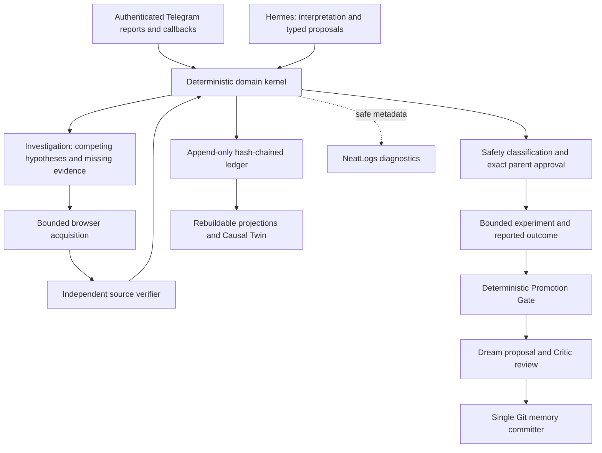

# Serene

**An evidence-bound family intelligence agent that helps parents investigate what may be happening with their child, and learn only within tested scope.**

LLM proposes; deterministic code decides. The repository is named `morrow`.

## The problem

A difficult daycare pickup could reflect fatigue, hunger or transition difficulty.
A parent needs a useful next observation, not a confident story from three anecdotes.
An assistant that treats fluent explanations or retrieved text as proof can turn a
guess into advice, then remember its own advice as fact. Serene keeps reports,
beliefs and reviewed memory separate, retains competing explanations, and requires
explicit parent authorization before a trial starts.

This is the design motivation, not a measured claim that Serene outperforms other
parenting assistants. It provides no clinical diagnosis or autonomous intervention.

## The architecture and trust boundary



The [kernel and admission rules](docs/architecture.md#kernel-and-authority-boundaries)
recheck provenance, safety, promotion and authorization. A model cannot grant these
permissions. External captures start UNVERIFIED; the independent verifier checks
the source, not the truth of every claim. Authenticated parent reports establish
who reported something, not objective truth. Parent approval is bound to one exact
intervention and prompt; text saying “approve” is insufficient.

The [epistemic ladder](docs/evidence-model.md#epistemic-ladder-and-promotion) goes
from raw evidence to contextual learning through adjacent, checked rungs. Dream
proposes a diff; the Critic and one committer govern publication. Refuted beliefs
remain inspectable. Cost cannot override safety or evidence quality.

Implemented services include Telegram, investigation/recovery, verification,
experiments, promotion, Dream, Git memory, Causal Twin and Supabase projections.
The web has Twin/Memory review views, an Experiments/Approval surface and the Realtime projection
transport (#33). Today and Investigations connect after Supabase sign-in and child selection (#87);
Memory, Experiments and the Causal Twin pages still render unconnected, and full Twin provenance
projection (#75) is unfinished.
Current investigation sufficiency can also mistake an empty/filtered plan for
completion; [the architecture records that limitation](docs/architecture.md#telegram-hermes-and-investigation).
The web approval command/channel exists, but its authenticated transport is unwired;
the shipped Experiments page offers no decisions.
[Implemented UI boundary](docs/architecture.md#experiments-promotion-and-dream).

## See the canonical Maya story

Use Python 3.11–3.13, Git and uv. From a fresh clone:

```sh
git clone https://github.com/Sathvikar01/morrow.git
cd morrow
uv sync --locked --all-extras --group dev
uv run python scripts/demo_reset.py
uv run python scripts/maya_demo.py
```

Open the generated `.demo/maya/report.html` in a browser; the companion JSON
contains events, provenance, memory content and the Git receipt. No credentials
or network services are needed for this synthetic demonstration.

Maya's pickup reports become fatigue, hunger and transition hypotheses. A missing
observation leads to a parent question, then browser research. An injected failure
retries; a plausible excerpt is rejected; a new capture passes six verifier checks.
A parent approves a reversible five-minute heads-up trial. Synthetic outcomes
support a scoped learning. Dream keeps the justified patch and rejects a universal
claim; the Twin shows one SUPPORTED edge and two CANDIDATE alternatives.

All 18 beats use real domain services, with scripted model/browser I/O and Telegram
updates. This proves offline integration, not a live bot or deployed family service.
[Exact script and evidence](docs/maya-demo.md), [E2E test](tests/test_maya_demo.py),
[final acceptance checklist](docs/final-demo-checklist.md).

```sh
uv run pytest -q tests/test_maya_demo.py tests/test_demo_reset.py
uv run python scripts/ledger_selfcheck.py
uv run python scripts/economics_report.py --check
uv run python scripts/docs_check.py --github
```

Reset restores only the fixed synthetic workspace, preserves unknown files and
refuses linked paths. Each demo uses a fresh in-memory ledger and temporary Git
repository. [Setup](docs/setup.md) covers optional live services; the offline path
needs no `.env`. [Web commands](app/web/README.md) preview separate synthetic UI
fixtures, not a connected family dashboard.

## Measured evaluation and the NeatLogs correction story

NeatLogs traces exposed bundled evidence requests being rejected as
`REQUESTED_FIELD_UNSUPPORTED`. Proposed [#67](https://github.com/Sathvikar01/morrow/pull/67)
splits acquisitions into bounded evidence units. **controlled-dev/1 = PASS** under
its frozen decision function, archived in [merged PR #89](https://github.com/Sathvikar01/morrow/pull/89).
Here A/B mean two Serene revisions, not the plain-Hermes/RAG baselines.

| Measured DEV result | A: prior revision | B: unmerged #67 |
| --- | ---: | ---: |
| Unsupported-field rejections | 62/62 | 3/39 |
| VERIFIED captures | 0 | 22 |
| Serene → Hermes attempts | 305 | 275 |
| Live suffix tokens | 4,187,529 | 3,863,797 |
| Terminal PARKED_UNRESOLVED | 36/36 | 36/36 |

The conditional rejection-rate improvement was 92.3%, with no safety/provenance
regressions under the declared guards. **All 72 runs still parked unresolved;
#67 is not merged; holdout was NOT run.** Task success was A 0/36, B 2/36.
This is no claim of general resolution, baseline superiority or statistical significance.

The frozen protocol used 36 shared-prefix pairs (27 live continuations, nine offline),
external deterministic scoring and one execution without replacement pairs.
54/54 live suffix trace exports were accepted. Raw worker states remain local;
the archive preserves per-pair metrics, hashes and independent recount receipts.
Measured tokens are not measured dollar spend: no provider price was configured.
[Report](docs/controlled-dev-1.md), [all pairs](eval/reports/archive/2026-10-12-controlled-dev-1/all-36-pairs.csv),
[trace receipts](eval/reports/archive/2026-10-12-controlled-dev-1/neatlogs-sessions.csv),
[verification](eval/reports/archive/2026-10-12-controlled-dev-1/verification.json).

Historical truth remains: original DEV **FAIL**, paired replay **INCONCLUSIVE**,
live-gate/3, /4 and /5 **INVALID**. The full regression gate requires holdout.
Plain Hermes and Hermes + ordinary memory/RAG are implemented comparators, but
this DEV result does not establish superiority over them.
[Methodology and historical reports](docs/evaluation.md).

The separate [historical six-run comparison](docs/live-eval-2026-10-11.md) is:

| System | Strict task success | Model calls | Tokens |
| --- | ---: | ---: | ---: |
| Serene | 0/6 | 83 | 988,176 |
| Baseline A: plain Hermes | 0/6 | 6 | 47,959 |
| Baseline B: Hermes + ordinary memory/RAG | 0/6 | 6 | 50,157 |

Consumption differs substantially. These historical scorer-version results do
not establish equal-consumption superiority or task success; they are distinct
from controlled-dev/1's two Serene revision arms.

## Economics and development provenance

**cfo.ai:** a genuine Scenario and saved readback support an **assumed** operating
case: $2.725256/family-month, 77.28% gross margin at assumed $12 revenue, and 524
days runway under assumed cash/burn. These are not measured production economics.
One constrained optional confirmation comparison estimates 9,038 versus 14,452
micro-USD for parent versus already authorized caregiver. Policy must certify
safety/quality/evidence equivalence first; the helper grants no access and sends
no messages. Default runtime costs remain unknown.
[Inputs, formulas and limitations](docs/economics.md),
[cfo.ai readback](docs/economics/cfo-readback.json),
[acceptance evidence](docs/economics/acceptance-audit.json).

**Entire:** the evolution runs through ledger/projections
([#63](https://github.com/Sathvikar01/morrow/pull/63)), policy/Dream/Twin
([#64](https://github.com/Sathvikar01/morrow/pull/64)), investigation/verifier
([#65](https://github.com/Sathvikar01/morrow/pull/65)) and evaluation correction
([#68](https://github.com/Sathvikar01/morrow/pull/68)). An eight-milestone reference
index was verified on the separate #54 branch. Genuine historical checkpoint
coverage is incomplete; **[#54](https://github.com/Sathvikar01/morrow/issues/54)
remains open**. Git references are not native checkpoint coverage. Session pushing
is disabled; no private transcript publication is needed to judge the work.
[Exact provenance limitation](docs/architecture.md#observability-economics-and-development-provenance).

## Privacy, security and release status

Only synthetic child data is used in public demos/evaluation. NeatLogs receives
allow-listed metadata with HMAC identifiers and token filtering, never intentional
child narratives; redaction is not a universal PII detector. Sink failure cannot
change a decision. Inference context is separate private provider processing.
Supabase RLS scopes reads; ledger writes stay backend-only. Hash chains detect
tampering but do not notarize history against a host administrator.
[Privacy and #59 audit](docs/privacy.md), [safety and non-goals](docs/safety.md).
Known Next.js/PostCSS advisories recorded in that audit require remediation before public hosting.

Four required CI checks cover kernel/types/tests/secrets, deterministic Inspect
gates, web build/unit tests and Playwright. **The final release gate remains BLOCKED**
by incomplete Entire checkpoints and the unrun holdout/full improvement gate;
the connected live UI is also not demonstrated. The offline Maya path is available.
[Checklist and exact submission narrative](docs/final-demo-checklist.md).

Canonical references: [architecture](docs/architecture.md),
[evidence](docs/evidence-model.md), [safety](docs/safety.md),
[privacy](docs/privacy.md), [evaluation](docs/evaluation.md).
