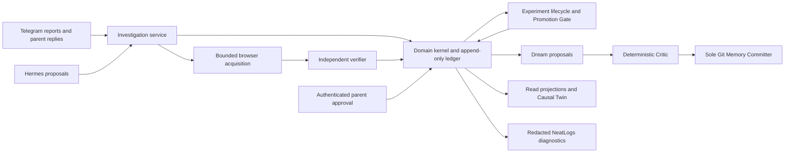

# Serene

**An evidence-bound family intelligence agent:** help a parent investigate what
might explain a child's behavior, test a safe idea with their approval, and retain
only a scoped, reviewable learning. The repository is named `morrow`.

> Models handle uncertainty; deterministic code handles authority.
> What happened ≠ what Serene remembers ≠ what Serene believes.

The canonical demo is **synthetic Maya's daycare pickup: fatigue vs hunger vs
transition difficulty**. It exercises the real runtime and domain services with
deterministic offline external I/O. It needs no credentials or production data.

## Run the canonical demo

Prerequisites: Git, [uv](https://docs.astral.sh/uv/) and Python 3.11–3.13.
Use a full clone; historical integrity tests read pinned Git objects.

```sh
git clone https://github.com/Sathvikar01/morrow.git
cd morrow
uv sync --locked --all-extras --group dev
uv run python scripts/demo_reset.py
uv run python scripts/maya_demo.py
```

Open the generated `.demo/maya/report.html` in a browser. The companion
`.demo/maya/report.json` contains the complete ledger, provenance, Causal Twin,
accepted memory content, rejection reason and Git commit receipt. The CLI prints
18 PASS rows and this canonical domain-report SHA-256:

```text
3752477f9a66d039ba6002c72cfe9dc2e03c8e1332ccf0fe3ab728df6db9dbb9
```

**One-command reset:** `uv run python scripts/demo_reset.py`. It restores the
fixed synthetic seed/empty-ledger baseline and removes only known generated
reports. It refuses linked targets, preserves unknown files, and takes no database
URL or arbitrary target. Running twice gives identical baseline bytes. Each demo
run uses a fresh in-memory ledger and a temporary real Git memory repository.
See [reset and reproducibility evidence](docs/maya-demo.md#reproducibility-and-judging)
and [reset tests](tests/test_demo_reset.py).

## Exact demo path

1. Three Telegram pickup updates enter the real authenticated channel adapter.
2. An investigation opens with fatigue, hunger and transition difficulty hypotheses.
3. Missing snack-response evidence triggers a parent YES/NO/UNSURE question; the
   synthetic parent answers NO on that exact interaction.
4. A bounded browser acquisition fails once, schedules a retry, then recovers
   for the same evidence request.
5. The independent verifier rejects an unsupported excerpt
   (`EXCERPT_NOT_ON_SOURCE`); a subsequent capture passes all six checks.
6. A reversible seven-day, five-minute heads-up experiment is proposed and
   classified GREEN. The parent approves the exact intervention before it starts.
7. Two pickup reports and a parent outcome support completion. The Promotion Gate
   admits 3→4 and 4→5, producing one scoped learning with review metadata.
8. Dream runs all six stages. The Critic accepts the scoped patch; the sole Memory
   Committer writes `learnings/maya-pickup.md` in the temporary memory repository.
9. Dream's universal claim from one observation is rejected with
   `INSUFFICIENT_EVIDENCE:OBSERVATION_BELOW_PATTERN` and is never written.
10. The Causal Twin shows transition difficulty SUPPORTED at level 5; fatigue and
    hunger remain CANDIDATE at level 3.

The [18-beat specification](docs/maya-demo.md#exact-path),
[fixture](serene/demo/maya.py), [report verifier](serene/demo/report.py) and
[E2E tests](tests/test_maya_demo.py) provide exact event/order evidence. Two
independent runs must have identical canonical bytes, including IDs, timestamps,
hash chain and memory Git commit.

Telegram sender, Hermes model wire and public-page fetch are scripted synthetic
I/O. This proves integration through the existing services, not live Telegram,
provider or website availability. The result is a scoped synthetic N-of-1 learning,
not a universal causal or clinical claim.

## Architecture and deterministic authority



Hermes interprets and proposes. Code owns admission, source verification,
GREEN/AMBER/RED classification, exact parent authorization, epistemic promotion
and memory publication. RED cannot be approved; prose cannot grant authority.
The append-only, per-child hash-chained ledger preserves evidence and lineage;
projections are disposable read views. Refuted and superseded beliefs remain
inspectable. These are trusted backend boundaries, not protection against an
operator controlling the host or database credentials.

Supabase/Postgres adapters, scoped read RLS and Realtime projection infrastructure
are implemented. The web has Causal Twin and Memory/Dream review surfaces, but
its default sources remain **UNCONNECTED**; no deployed authenticated family-data
service is claimed. Maya's generated HTML displays actual domain results.
See [architecture and exclusions](docs/architecture.md),
[evidence rules](docs/evidence-model.md), [safety](docs/safety.md) and
[privacy audit](docs/privacy.md).

## Evaluation: measured results and limits

Inspect AI runs structured scenarios with external deterministic scorers; the
agent never grades itself. Mock-model CI checks invariants, not live-model quality.
[Methodology](docs/evaluation.md) distinguishes baseline comparisons, conditional
shared-prefix DEV experiments and the full DEV-plus-holdout regression gate.

Historical comparison ([2026-10-11 report](docs/live-eval-2026-10-11.md), six runs
per system, historical scorer versions):

| System | Strict task success | Model calls | Tokens |
| --- | ---: | ---: | ---: |
| Serene | 0/6 | 83 | 988,176 |
| Baseline A: plain Hermes | 0/6 | 6 | 47,959 |
| Baseline B: Hermes + ordinary memory/RAG | 0/6 | 6 | 50,157 |

Serene recorded zero authority/epistemic violations in those runs; both baselines
made premature-causality assertions in all six. Consumption differs substantially,
so this does not establish equal-consumption superiority or task success.

**controlled-dev/1 = PASS**, merged in
[PR #89](https://github.com/Sathvikar01/morrow/pull/89). This compares two Serene
revisions, not the plain-Hermes/RAG baselines: A `8fac1cb`, B `41d3bf6` (#67).
One execution used 36 fixed DEV tapes, shared replay until policy/input divergence,
then 27 live suffixes per arm through normal Hermes, A then B, with no reruns.

| Conditional DEV metric | A | B |
| --- | ---: | ---: |
| Unsupported-field rejection rate | 62/62 | 3/39 |
| VERIFIED captures | 0 | 22 |
| Live attempts | 305 | 275 |
| Reported live tokens | 4,187,529 | 3,863,797 |
| Task success | 0/36 | 2/36 |
| Terminal states | 36 parked unresolved | 36 parked unresolved |

The unsupported rejection rate improved 92.3% relatively. Hard safety/provenance
checks passed; no scenario met the consistent paired investigation regression rule.
One pair worsened, and no arm reached COMPLETE. Monetary cost is uncomputed
(provider pricing unset); remote sampling is nondeterministic. One Hermes-internal
retry is disclosed separately from zero Serene-visible transport failures.

The [final report](docs/controlled-dev-1.md),
[archived summary](eval/reports/archive/2026-10-12-controlled-dev-1/summary.json),
[all paired rows](eval/reports/archive/2026-10-12-controlled-dev-1/all-36-pairs.csv)
and [verification receipt](eval/reports/archive/2026-10-12-controlled-dev-1/verification.json)
preserve the result. It establishes eligibility for a one-time holdout;
**holdout has not run and #67 remains unmerged**. Original DEV remains FAIL,
paired replay INCONCLUSIVE, live-gate/3, /4 and /5 INVALID. None is overwritten.

## NeatLogs: observed failure and incomplete improvement acceptance

The [live diagnosis](docs/live-eval-2026-10-11.md#what-this-shows-and-what-it-does-not)
found bundled browser fields that could not all be supported by one passage;
the verifier correctly refused them and the evidence budget ran out.
[PR #67](https://github.com/Sathvikar01/morrow/pull/67) proposes one independently
verifiable evidence unit per request, retaining the verifier. The conditional DEV
result above measures improved evidence quality; all 54 live suffixes have accepted
NeatLogs exports, listed in the
[session receipt index](eval/reports/archive/2026-10-12-controlled-dev-1/neatlogs-sessions.csv).
Raw states remain local with archived hashes. Export acceptance alone does not
prove a trace's diagnosis or a causal effect.

[#53 stays open](https://github.com/Sathvikar01/morrow/issues/53#issuecomment-6115724807):
the full regression gate lacks holdout evidence, so there is no completed
before→after success claim. SafeTelemetry allow-lists/token-validates metadata;
the sink redacts again. This is not a universal PII detector. The offline Maya
command makes no live NeatLogs export. See [privacy](docs/privacy.md).

## Entire: development evolution and honest limitation

Merged milestones map ledger/projections to
[PR #63](https://github.com/Sathvikar01/morrow/pull/63), Promotion Gate/Causal
Twin/Dream to [PR #64](https://github.com/Sathvikar01/morrow/pull/64),
ingestion/investigation/verifier to
[PR #65](https://github.com/Sathvikar01/morrow/pull/65), and evaluation infrastructure
correction to [PR #68](https://github.com/Sathvikar01/morrow/pull/68).

[#54 is incomplete](https://github.com/Sathvikar01/morrow/issues/54). An eight-milestone
repository-reference index exists on its local work branch, not merged main.
Verified Git references do not establish genuine, ordered, retrievable Entire
checkpoints for every milestone. Session pushing and telemetry remain disabled in
[Entire settings](.entire/settings.json). No transcripts are published to manufacture
coverage. See the [audited provenance status](docs/architecture.md#observability-economics-and-development-provenance).

## cfo.ai: economics, with an authority boundary

[#55](https://github.com/Sathvikar01/morrow/issues/55) produced a genuine cfo.ai
Scenario and [readback](docs/economics/cfo-readback.json), with
[reproducible local inputs](docs/economics/inputs.json) and
[acceptance audit](docs/economics/acceptance-audit.json). Under **assumed** $12 monthly
revenue, the model yields **$2.725256 per family-month**, **77.28% gross margin**
and 524 days of runway under its cash/burn assumptions. These are modeled values,
not measured production bills. [Sensitivity and limitations](docs/economics.md)
show how usage and pricing affect the result.

Cost can break a tie only for an optional pickup confirmation after policy
certifies equivalent safety, quality and evidence between parent and an already
authorized caregiver. The helper grants no access and sends no messages; the
default runtime does not globally plan by price. Cost cannot override safety,
evidence quality, verification or parent authority.

## Verification and optional integrations

```sh
uv run pytest -q tests/test_demo_reset.py tests/test_maya_demo.py
uv run python scripts/ledger_selfcheck.py
uv run python scripts/docs_check.py --github README.md
uv run python scripts/economics_report.py --check
uv run pytest -q
```

`--github` needs authenticated `gh` for read-only reference validation. The full
backend suite uses a local bundled PostgreSQL, or `SERENE_TEST_DATABASE_URL` for
a dedicated test database; CI uses PostgreSQL 17 and applies all migrations.
Four [required CI jobs](docs/setup.md#5-merge-gates-58) cover backend tests,
lint/types, migration/RLS checks, deterministic Inspect safety/promotion smoke,
frontend typecheck/unit/build and Playwright. No provider key is needed for CI.

For optional live integrations, copy [.env.example](.env.example) to an ignored
local `.env`, then follow [setup](docs/setup.md) and [runtime](docs/runtime.md).
The canonical offline demo does not need this step. For the separate web UI:

```sh
cd app/web
npm ci
npm run dev
```

See [web setup and synthetic fixtures](app/web/README.md). The web UI is not the
canonical Maya runtime viewer. Public hosting is not certified: the last dependency
audit found Next/PostCSS advisories, separate from the completed secrets/logging
audit. Address that release blocker before exposing a public build.

## Documentation and current limits

- [Architecture](docs/architecture.md), [evidence](docs/evidence-model.md),
  [epistemic ladder](docs/epistemic-model.md), [event model](docs/event-model.md).
- [Safety](docs/safety.md), [privacy](docs/privacy.md), [evaluation](docs/evaluation.md).
- [Maya demo/reset](docs/maya-demo.md), [economics](docs/economics.md), [setup](docs/setup.md).

Synthetic data only in demos/evals. Serene is not clinical diagnosis or treatment;
there is no population causal, statistical significance, production readiness or
baseline-superiority claim. #53/#54 remain open, #67/#69 are unmerged, and the
live default web connection and complete provenance projection (#75) remain gaps.
The working deterministic domain demo is distinct from those unfinished claims.
