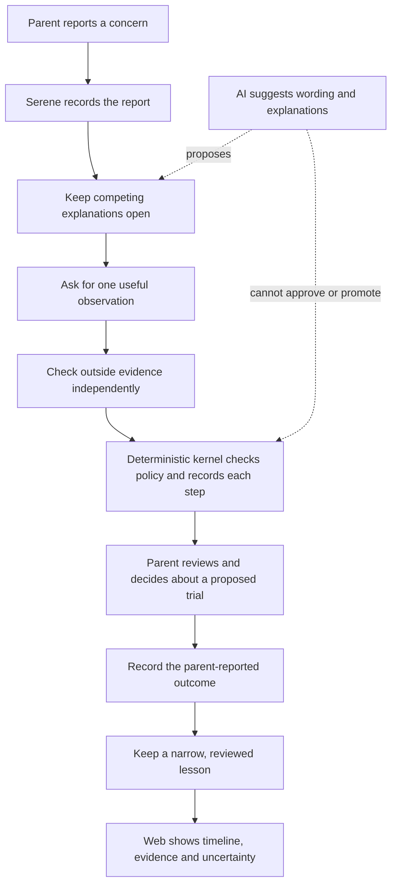

# Serene architecture

## One-minute picture

Serene helps a parent move from a concern to a careful next step. It records
what the family reported, keeps plausible explanations visible, checks outside
evidence separately, and asks the parent before a trial. The web screen is a
window into that saved record; it does not decide what to believe or do.



**Reading the diagram:** the AI offers suggestions. Deterministic code applies
the rules, and the parent retains authority over a trial. Each timeline entry
comes from the saved record, including repeated checks and pauses. A verified
web source confirms what that source contained; it does not prove what happened
to a child.

The [Maya story](maya-demo.md) walks through the flow and includes screenshots
of the user interface. It is fictional and uses scripted external responses.

Audited against merged `main` at `6b8207300271620e775d33879add3533d59ad992`
on 2026-10-12 for [#60](https://github.com/Sathvikar01/morrow/issues/60).
Implementation, synthetic integration, live evaluation and production readiness
are different claims. The [Maya demo](maya-demo.md) exercises real services with
scripted external I/O; [evaluation.md](evaluation.md) records the limits of live results.

## Thesis and state ownership

Serene is an evidence-bound family intelligence agent: help a parent investigate
what may be happening with their child, preserve competing explanations, ask for
the smallest useful missing observation, and learn only within tested scope.
**LLM proposes; deterministic code decides.** This is the authority design;
the investigation-completion gap below is a current implementation limitation.

```text
Experience                         Memory                       Belief
what was reported/done              reviewed durable knowledge   current interpretation
append-only event ledger           Git + Markdown               replayed ledger state
```

Experience is never overwritten by a model's interpretation. Memory cannot
promote belief, and Hermes conversation memory cannot become Serene memory.
[ContextRetriever](../serene/investigation/context.py) retrieves all three
separately; [#29](https://github.com/Sathvikar01/morrow/issues/29) and
[memory tests](../tests/test_memory_committer.py) cover their separation.

## Kernel and authority boundaries

The Pydantic domain kernel uses ports for replaceable infrastructure. Kernel
packages cannot import Hermes, adapters, database/model SDKs, NeatLogs or Inspect;
[architecture tests](../tests/test_architecture_boundaries.py) enforce imports
and kernel dependency direction ([#2](https://github.com/Sathvikar01/morrow/issues/2)).

| Concern | Implemented owner and evidence | Boundary |
| --- | --- | --- |
| Interpretation, hypotheses, evidence candidates | [AgentRuntime port](../serene/ports/agent_runtime.py), [Hermes runtime](../serene/adapters/hermes/runtime.py) | Typed proposals, abstention or evidence requests; no policy grants |
| Investigation execution | [InvestigationService](../serene/investigation/service.py), [phase policy](../serene/policies/investigation.py) | Ledger-guarded transitions and persisted budgets; completion limitation below |
| Acquisition selection | [MinimumDataPolicy](../serene/investigation/minimum_data.py) | Computes safety, need, ordinal information value, burden/latency and constrained cost ordering from proposed candidates |
| External evidence trust | [IndependentEvidenceVerifier](../serene/evidence/verifier.py) | Independent re-fetch; browser/model cannot verify their own capture |
| Belief level | [Promotion Gate](../serene/policies/promotion.py) | Structured provenance and rung checks; rationale cannot grant promotion |
| Intervention safety | [classifier](../serene/policies/safety.py), [experiment requirements](../serene/policies/experiments.py) | GREEN/AMBER/RED and structural checks; RED cannot be approved |
| Parent authorization | [approval policy](../serene/policies/approval.py), [Telegram channel](../serene/adapters/telegram/channel.py) | Authenticated parent receipt bound to intervention, class, expiry and single use |
| Durable memory publication | [Critic policy](../serene/policies/memory_review.py), [MemoryCommitter](../serene/memory/committer.py) | Dream proposes; only reviewed, ledger-authorized Git changes publish |

[EventLedger.append_event](../serene/ledger/service.py) validates taxonomy,
payload, actor and verification status, verifies the existing hash chain, checks
ancestors and stateful admission, seals the event, then appends with an expected
head. [Admission](../serene/policies/admission.py) recomputes promotion,
classification, approval/start and memory-review decisions; a `POLICY` actor
label alone grants nothing. Refusal writes no domain event. Services record
explicit block/rejection events where supported; diagnostic refusal codes go
through safe telemetry. See [adversarial tests](../tests/test_admission_adversarial.py).

These are trusted backend boundaries, not a sandbox against an operator who
controls database credentials, code or the host. Parent/channel identity must
be established by the adapter; actor enums alone are not authentication.

## Telegram, Hermes and investigation

The [Telegram adapter](../serene/adapters/telegram/channel.py) authenticates the
webhook secret, accepts bound private senders and preserves raw reports before
structuring. An approval button must match its user/chat/message/token and unused
prompt; text saying “approve” stays an observation. First-hand VERIFIED means
channel-authenticated report, not an objectively proven account. Callback tests:
[Telegram ingestion](../tests/test_telegram_ingestion.py),
[investigation approval](../tests/test_investigation_approval.py) (#9, #40).

Hermes provides reasoning and bounded browser execution through the
[Responses transport](../serene/adapters/hermes/transport.py), not the policy
engine or Telegram identity registry. Missing live configuration fails closed.
The [runtime contract](runtime.md) distinguishes real transport from scripted
demo responses; Serene owns its investigation controller.

```text
UNDERSTANDING -> RETRIEVING_CONTEXT -> FORMING_HYPOTHESES -> NEEDS_EVIDENCE
  -> ASKING_HUMAN or RESEARCHING -> VERIFYING -> EVALUATING
  -> NEEDS_EVIDENCE / NEEDS_APPROVAL / COMPLETE / PARKED_UNRESOLVED
```

The controller forms at least two competing hypotheses, retrieves experience,
reviewed memory and belief separately, then selects at most one acquisition per
round. Parent micro-answers are YES/NO/UNSURE. External captures enter UNVERIFIED;
verification is separate. Failed acquisitions and retry counts persist in the
ledger. Default budgets are six model runs, three evidence rounds and 32 steps
per drive; unavailable services, exhausted budgets or parent timeout can park
unresolved. Terminal phases cannot resume. See [controller tests](../tests/test_investigation.py)
and [evidence-model.md](evidence-model.md) (#10–#16, #21).

**Current completion limitation:** `Selection.sufficient` is `chosen is None`.
An empty plan, or candidates all filtered out, can lead `_evaluating` to COMPLETE.
Admission checks an active hypothesis, no open request and no pending verification;
it does not prove every competing pair was discriminated. An inventive planner
can conversely keep requesting until budget exhaustion. Draft
[PR #69](https://github.com/Sathvikar01/morrow/pull/69) proposes stronger sufficiency
but is unmerged and unjudged. Do not describe that fix, or
[PR #67](https://github.com/Sathvikar01/morrow/pull/67)'s single-field acquisition
change, as current `main` behavior. #67's conditional DEV evaluation is now PASS
([merged report](controlled-dev-1.md)); its holdout has not run and the product
change remains unmerged. COMPLETE does not itself promote a hypothesis.

## Experiments, promotion and Dream

[ExperimentLifecycleService](../serene/experiments/service.py) connects proposal,
classification, approval request, authenticated parent decision, start, outcome
and completion/abandonment/timeout. Explicit reversible intervention, outcome
measure, comparison and bounded context are required. Timeouts never approve.
Outcome collection and deterministic promotion are separate steps (#22–#26).

The [epistemic ladder](evidence-model.md#epistemic-ladder-and-promotion) runs
raw evidence → observation → pattern → hypothesis → tested hypothesis → contextual
learning. Approved completed trials and supporting outcomes enable higher rungs;
contradictions, rivals, tested scope and review metadata constrain learning.
N-of-1 support is not a statistical causal estimate or clinical validation.

[DreamPipeline](../serene/memory/dream.py) records six stages:
ORIENT → CONSOLIDATE → REFLECT → CHALLENGE → VERIFY → PROPOSE_PATCH.
The Dreamer supplies prose; code fills level/status/scope/validity/sources and
counterevidence from ledger facts. Dream has read-only memory access and cannot
commit. The deterministic Critic checks the full diff, lineage, authority,
contradictions and current base. The single writer prepares a Git object,
records the exact authorized SHA in the ledger, then publishes by compare-and-set.
Out-of-band or unpublished commits fail the memory audit; this is not an atomic
transaction across Git and Postgres. Refuted/stale knowledge is retained and
deprecated, never silently deleted. Tests: [Dream](../tests/test_dream.py),
[Memory Committer](../tests/test_memory_committer.py) (#28–#32).

The merged [Memory/Dream read view](../serene/memory/view.py) and
[review surface](../app/web/components/memory/MemoryView.tsx) (#36,
[PR #83](https://github.com/Sathvikar01/morrow/pull/83)) expose kept memory,
lineage, Dream stages, pending patches and explained refusals. They carry no
edit, commit or approval authority. Memory text and diffs remain private data;
the build-gated fixture is synthetic, not a live family connection.

Main also includes #37's [Experiments view](../serene/experiments/view.py),
[decision surface](../app/web/components/experiments/DecisionPanel.tsx) and
[WebApprovalChannel](../serene/adapters/web/approvals.py). Commands quote the
shown intervention digest/safety class and a single-use request ID; channel and
ledger admission reject RED and recheck parent, expiry, replay and deliberation.
The channel trusts a principal resolved by an authenticated transport; it does
not authenticate sessions itself: the [HTTP boundary](../serene/adapters/web/http.py)
(#84) does, behind the web app's same-origin `/api/approvals` relay. The
[page](../app/web/app/experiments/page.tsx) reads the `experiments` projection
(the same view, as of the head event; the kernel re-checks expiry on every
decision) for the signed-in parent's chosen child (#87), and shows a new stage
only when that projection changes. A scripted fixture response is not a real
parent approval. Tests: [web approvals](../tests/test_web_approvals.py),
[HTTP boundary](../tests/test_web_approval_http.py), [read view](../tests/test_experiments_view.py).
The [shipped-page browser proof](web-e2e-proof.md) exercises the production
transport with a test kernel and PostgreSQL; real Supabase Auth/Realtime
acceptance remains pending.

## Causal Twin, Supabase and projections

[build_causal_twin](../serene/causal/model.py) derives one edge per hypothesis
from the ledger: CANDIDATE, SUPPORTED, REFUTED or SUPERSEDED. It includes
observational/experimental support, counterevidence, confounders, alternatives,
scope, provenance and learning validity. SUPPORTED requires experimental support
at level ≥4 without contradicting outcomes; it is not a numeric confidence or
effect size. Refuted and superseded edges remain inspectable
([tests](../tests/test_causal_twin.py), #27).

The [Postgres adapters](../serene/adapters/postgres.py) implement per-child
hash-chained events and disposable projection storage. Advisory locks plus head
compare-and-set and uniqueness prevent stream forks; SQL triggers reject ledger
UPDATE/DELETE/TRUNCATE. Hash verification detects changed historical bytes but
is not an external notarization against wholesale history replacement. See
[migrations](../supabase/migrations/), [ledger tests](../tests/test_postgres_ledger.py).

[Pure read projections](../serene/projections/views.py) (the five initial ones and the
surface views: `investigations`, `experiments`, `causal_twin`) rebuild from replay.
Projection rows can be replaced/deleted; they cannot authorize a ledger append.
The `serene` schema has parent/caregiver-scoped read policies,
synthetic-only eval access and backend-only ledger writes
([RLS migration](../supabase/migrations/20261011120000_serene_rls_access.sql),
[RLS tests](../tests/test_rls.py), #6, #8). The current
[Supabase API config](../supabase/config.toml) exposes this schema through
PostgREST for projection snapshots; schema exposure does not bypass RLS.
See [privacy.md](privacy.md).

Merged #33 ([PR #86](https://github.com/Sathvikar01/morrow/pull/86)) adds an
optional `EventLedger(after_append=...)` projection publisher. Its monotonic
upsert advances read rows after durable append; hook failure leaves the ledger
committed and read state lagging until a later publish/rebuild. The
[Realtime migration](../supabase/migrations/20261012150000_projection_realtime.sql)
publishes only `serene.projection_state`, never the ledger. The
[web feed](../app/web/lib/projections/supabase.ts) reads a child-filtered
PostgREST snapshot and subscribes under the signed-in user's RLS. Its
[sync controller](../app/web/lib/projections/sync.ts) retains highest sequences,
resnapshots on reconnect and labels connection state explicitly
([publisher tests](../tests/test_projection_realtime.py)). The hook is opt-in;
the default application assembly does not wire it into a deployed service.

The investigations projection carries an optional `phase_history`: each saved
visit includes its ledger sequence, phase, timestamp and reason codes. The web
validates ascending sequence order and that the final visit matches the current
phase, then displays repeats and pauses as recorded. It never rebuilds this
timeline in the browser. Older projection rows without history show the current
stage and explain that earlier steps were not included.

The web has React Flow rendering and an inspectable provenance panel (#34, #38,
#39; [PR #74](https://github.com/Sathvikar01/morrow/pull/74)) with the complete
provenance projection of every edge (#75). `/causal-twin` reads the selected
child's `causal_twin` projection row through the signed-in feed
([LiveCausalTwin](../app/web/components/causal-twin/LiveCausalTwin.tsx)), like
Investigations and Experiments. The canonical twin (`causal-twin/1`) carries
child and actor ids and is pinned by the Maya report, so it is not published;
the row is a web-only format instead,
[`causal-twin-web/1`](../serene/causal/web.py): the map's variables (opaque
`var_` ids), each edge's kernel verdict, scope, support, counterevidence,
experiments and the creating actor's *kind*, and the #75 provenance view, with
validators that the two agree and a builder that refuses any child, actor or
source id. Its time is the ledger head's, like `experiments`, so a review date
takes effect on the next admitted event. Production hypotheses carry no
variable names, so live edges are listed rather than drawn between guessed
endpoints. The build-gated
[fixtures](../app/web/fixtures/synthetic-causal-twin-web.json) are kernel output.
The [live Twin browser lane](web-e2e-proof.md) runs against a test kernel with
real PostgreSQL and RLS; offline Maya HTML/JSON reports and that lane do not
establish a deployed family database connection.

## Observability, economics and development provenance

NeatLogs receives allow-listed, token-validated metadata via
[SafeTelemetry](../serene/observability/telemetry.py); the
[sink](../serene/adapters/neatlogs_sink.py) redacts again, refuses redirects,
bounds exports and reports fixed failure codes. Sink failure cannot change a
kernel decision. #59's merged privacy audit
([PR #80](https://github.com/Sathvikar01/morrow/pull/80)) covers secret/env/synthetic
scans and error boundaries; it does not certify third-party logging or production
privacy. Traces diagnose behavior; they never supply belief or approval authority.

cfo.ai is an analysis workspace. #55's genuine Scenario/readback supports an
**assumed** integer unit-economics model, not measured production billing.
[The constrained helper](../serene/adapters/cfoai.py) uses cost only for one
optional parent-versus-authorized-caregiver pickup confirmation after trusted
policy certifies safety/quality/evidence equivalence. It grants no access and
sends no messages. Default [runtime assembly](../serene/investigation/assembly.py)
uses unknown costs; the helper is not a globally enabled price-driven planner.
See [economics.md](economics.md), [acceptance evidence](economics/acceptance-audit.json),
[tests](../tests/test_cfoai_economics.py) and
[PR #76](https://github.com/Sathvikar01/morrow/pull/76).

**Entire #54 is incomplete and remains open.** A verified eight-milestone
repository-reference index exists on the local #54 work branch
(`8b15e36befa96cea506344ffba310d0fcbdbad44`), not in this audited `main`.
It maps ledger/projections to [PR #63](https://github.com/Sathvikar01/morrow/pull/63),
Promotion Gate/Causal Twin/Dream to [PR #64](https://github.com/Sathvikar01/morrow/pull/64),
ingestion/investigation/verifier to [PR #65](https://github.com/Sathvikar01/morrow/pull/65),
and evaluation infrastructure correction to [PR #68](https://github.com/Sathvikar01/morrow/pull/68).
Verified commits and ordered references are not genuine historical checkpoints.
The #54 audit reported only two directly retrievable local checkpoint records; several referenced records
were unavailable and the evaluation milestone had no checkpoint asserted. Full
ordered/retrievable coverage and native issue metadata are unestablished.
[Issue #54](https://github.com/Sathvikar01/morrow/issues/54) still requires that
coverage. This #60 audit revalidated the index's Git/GitHub references, not native
checkpoint completeness. [Entire settings](../.entire/settings.json) keep session pushing and
telemetry disabled; transcripts must not be published to manufacture completion.
Entire has no product evidence, policy or memory authority.

## Non-goals and excluded technologies

Serene intentionally does not permit LLM authority over policy, autonomous parent
approval, unverified evidence promotion, cost overriding safety/quality, silent
uncertainty, or hidden deletion of refuted beliefs. Known completion limitations
are disclosed above. It makes no clinical diagnosis/treatment, population causal
claim, automated intervention delivery or production-readiness claim. Evaluation
agents cannot grade themselves or alter frozen gates; see [safety.md](safety.md)
and [evaluation.md](evaluation.md).

The following exclusions are recorded in the
[original architecture decision table](https://github.com/Sathvikar01/morrow/blob/a0d198be1a4e55525bb3c993da690d1f78859518/docs/architecture.md).
They describe MVP scope, not claims that these technologies are inherently unsafe.
Current ownership is shown alongside the historical rationale.

| Excluded | Recorded rationale and current implementation |
| --- | --- |
| Graphiti, Supermemory, Vektori, Mem0, Hindsight | Inspectable Git/Markdown memory with one governed writer; use Dream/Critic/MemoryCommitter |
| OpenClaw | Hermes is the chosen runtime behind replaceable ports |
| LangGraph, Temporal, Restate, Hatchet, DBOS | Avoid a second orchestration system; current Serene controller owns phases and Hermes executes bounded reasoning/tools |
| Ax | Prompt optimization cannot replace deterministic authority checks |
| DoWhy, pgmpy, Cleanlab | Custom deterministic epistemic rules; no statistical causal estimation in this MVP |
| OPA, OpenFGA, SpiceDB | Keep authorization in the small kernel policy and Supabase RLS boundary |
| SurrealDB, ElectricSQL | Supabase/PostgreSQL is canonical; no second database/sync layer |
| PostHog, Jev | Chosen roles are NeatLogs diagnostics, Entire development provenance and cfo.ai analysis; Entire coverage remains incomplete |
